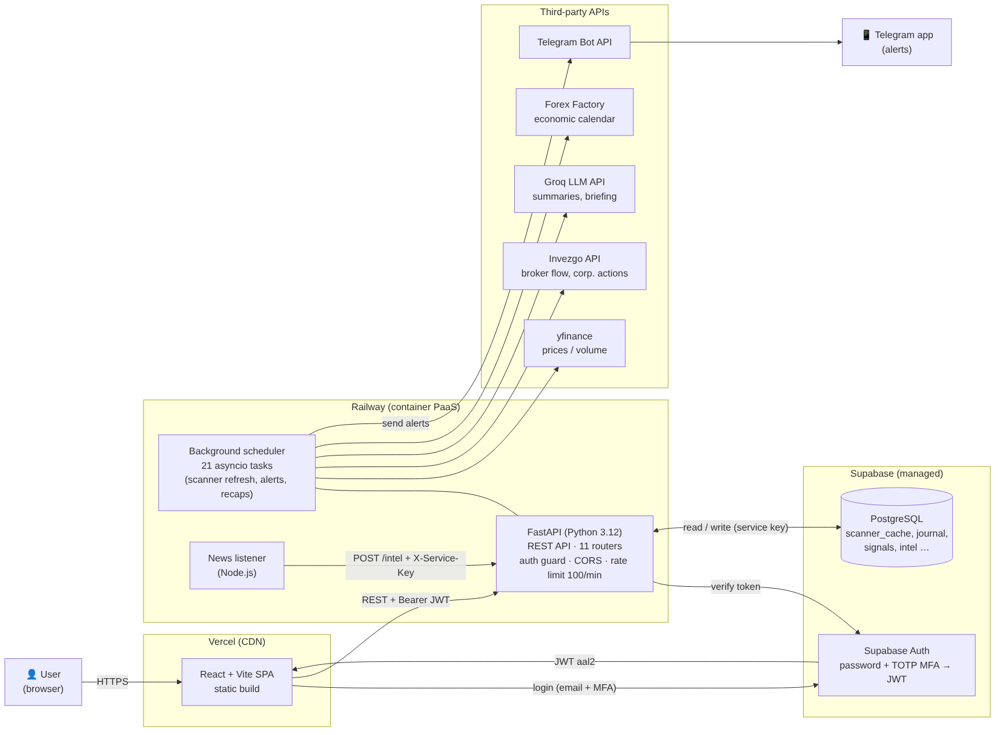
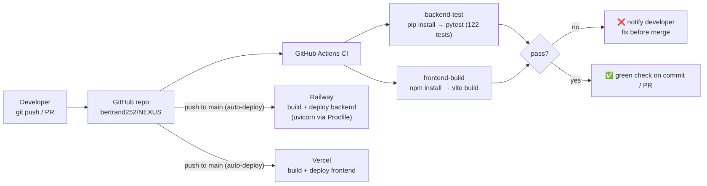
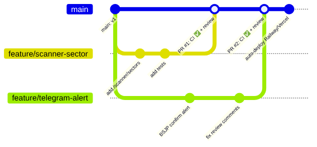

# NEXUS

**English** · [繁體中文](README.zh-TW.md) · [Bahasa Indonesia](README.id.md)

NEXUS is an AI-assisted analysis platform for the Indonesian stock market (IDX). It combines price data, broker flow, news and the economic calendar into scored trading signals, and sends alerts to Telegram automatically.

🔗 Live app: [nexus-idx.vercel.app](https://nexus-idx.vercel.app) · 📄 Full write-up: [docs/architecture/NEXUS_Cloud_Architecture.pdf](docs/architecture/NEXUS_Cloud_Architecture.pdf)

## Main features

| Feature | What it does |
| --- | --- |
| Stock scanner | Scores 951 IDX tickers 0–100: Volume /25, Price momentum /25, Accumulation (broker flow) /30, Technical breakout /20. Results are cached in `scanner_cache` and refreshed after market close. |
| Stock detail | Candlestick chart, support/resistance, XGBoost price-direction model, broker summary and foreign flow. |
| Telegram alerts | Automatic alerts for swing breakouts, end-of-day "BSJP" setups and intraday momentum, each with entry, target and stop-loss, plus large-transaction ("whale") alerts. |
| AI daily briefing | News posted to `/intel` is summarised by an LLM (Groq) into a daily briefing grounded in the scanner's own signals. |
| Journal & analytics | Trading journal with calendar view, portfolio simulation, and a history of every automatic call with its result. |

## Cloud architecture



**Request flow (user opens the Scanner page)**
1. The browser loads the React single-page app from Vercel's CDN.
2. The user logs in with email + password **and** a TOTP code. Supabase Auth returns a JWT with assurance level `aal2`.
3. The frontend calls `GET /scanner` on the FastAPI backend (Railway) with `Authorization: Bearer <JWT>`.
4. The auth guard verifies the token with Supabase and rejects tokens without MFA.
5. The router reads pre-computed scores from PostgreSQL and returns JSON. Scores are pre-computed because fetching 951 tickers on every page load is too slow and hits the data provider's rate limit.

**Background flow (no user involved)**
On startup, FastAPI's `lifespan` hook launches 21 `asyncio` background tasks (e.g. scanner refresh at 16:00 WIB, intraday momentum check every 15 minutes during market hours, morning briefing at 08:45). Each task pulls data from third-party APIs, writes to PostgreSQL and sends alerts through the Telegram Bot API. A small Node.js listener forwards news to `POST /intel` using a machine-to-machine service key.

## Cloud services and why

| Service | Role | Why |
| --- | --- | --- |
| **Railway** | Runs the FastAPI backend and the news listener | The scheduler must run 24/7 to send alerts at fixed market times; serverless functions that sleep between requests would miss them. Railway runs a long-lived process and keeps secrets in environment variables. |
| **Supabase** | Managed PostgreSQL + authentication | One service provides a relational database and a ready-made auth system with TOTP MFA. |
| **Vercel** | Hosts the React frontend | The frontend is a static build, so a CDN is the cheapest and fastest option. |
| **GitHub Actions** | Continuous integration | Runs tests and the frontend build on every push and pull request. |
| **Groq** | LLM inference | Fast, low-cost inference; the model is one environment variable, so switching providers is a one-line change. |

Trade-off: these PaaS products cost almost nothing at single-user scale and need little operations work, but give less control over networking and scaling than AWS/GCP.

**The same design on AWS**

| NEXUS today | AWS equivalent |
| --- | --- |
| Railway container | ECS Fargate behind an Application Load Balancer |
| 21 in-process asyncio tasks | EventBridge Scheduler → separate ECS tasks or Lambda (so the API can scale without running jobs twice) |
| Supabase PostgreSQL | Amazon RDS for PostgreSQL |
| Supabase Auth | Amazon Cognito with MFA |
| Vercel | S3 + CloudFront |
| Environment variables | AWS Secrets Manager |
| Railway logs | CloudWatch Logs + alarms |

## Security

- **MFA enforced at the API**: `backend/auth_guard.py` only accepts JWTs with `aal = "aal2"`.
- **Service key for machines**: compared with `hmac.compare_digest` (constant-time).
- **One auth gate**: authentication is attached once per router in `main.py`, so a new endpoint cannot be left unprotected by accident.
- **CORS** limited to the frontend origin; **rate limit** of 100 requests/minute per IP.
- **Secrets** live only in environment variables; see `backend/.env.example`.

## CI/CD



GitHub Actions runs two jobs on every push and pull request to `main`: `backend-test` (122 pytest unit tests with dummy credentials, no real service is called) and `frontend-build`. Railway and Vercel deploy from `main`. Next step: make CI a required check before merge so a failing build cannot reach production.

## Git workflow for a team



1. Each change starts on a `feature/<name>` branch from `main`.
2. Small commits; open a pull request when ready.
3. CI must pass and a teammate reviews the PR.
4. Merge to `main`, which deploys automatically.

NEXUS is a solo project, so I push to `main` directly; I use this flow in my 4-person final project.

## How AI tools were used

I designed the product, the features and the trading rules from my own trading practice, and used **Claude (Anthropic)** as an AI coding assistant for most of the implementation. I reviewed the results by running them, asked for fixes when behaviour was wrong (many came from real use), deployed the system and use it every trading day. Asking for automated tests and running them in CI caught mistakes that reading the code alone would have missed.

## Known limitations

- The scheduler runs inside the API process, so running two instances would duplicate alerts.
- Rate-limit counters are in memory and reset on redeploy.
- Without an Invezgo subscription, the Accumulation score falls back to placeholder values.
- Code comments are in Indonesian.

## Tech stack

| Layer | Technology |
| --- | --- |
| Backend | FastAPI (Python), asyncio scheduler |
| Database | Supabase (PostgreSQL) |
| Auth | Supabase Auth (JWT + TOTP MFA), service key for service-to-service calls |
| AI / LLM | Groq (`openai/gpt-oss-120b`), XGBoost |
| Market data | yfinance, Invezgo API |
| Alerts | Telegram Bot API |
| Frontend | React (Vite), Tailwind, Chart.js, lightweight-charts |
| Hosting | Railway (backend, news listener), Vercel (frontend) |

## Run locally

```bash
# frontend
cd frontend-react
npm install
npm run dev        # needs .env with VITE_API_BASE, VITE_SUPABASE_URL, VITE_SUPABASE_ANON_KEY

# backend
cd backend
python -m venv venv && source venv/bin/activate   # Windows: venv\Scripts\activate
pip install -r requirements.txt
python -m uvicorn main:app --reload --port 8000   # env vars: see backend/.env.example

# tests
cd backend && pytest
```

> NEXUS is an analysis tool, not investment advice. Signals are based on historical and technical data and do not guarantee future results.
