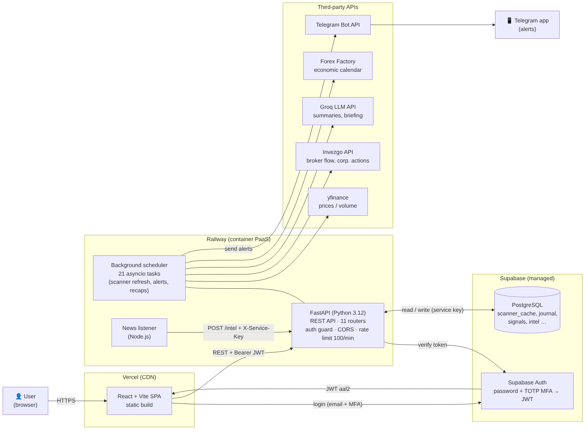
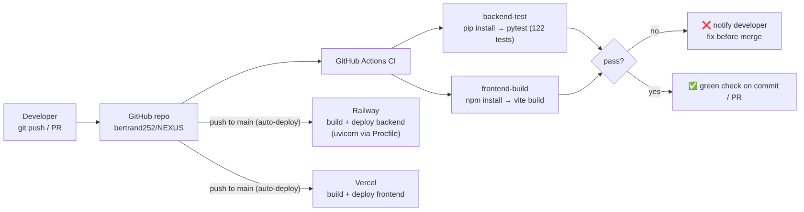
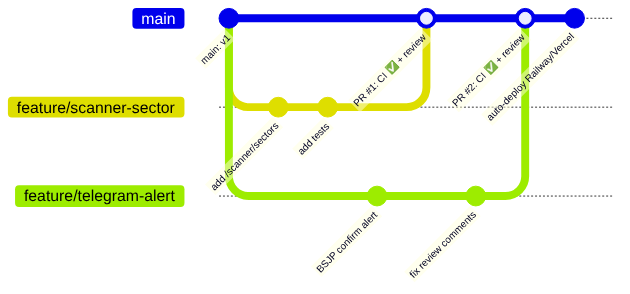

# NEXUS

[English](README.md) · **繁體中文** · [Bahasa Indonesia](README.id.md)

NEXUS 是一個 AI 輔助的印尼股市（IDX）分析平台。它整合股價資料、券商進出、新聞與經濟行事曆，計算股票評分並產生交易訊號，自動透過 Telegram 推播提醒。

🔗 線上系統：[nexus-idx.vercel.app](https://nexus-idx.vercel.app) · 📄 完整說明文件：[docs/architecture/NEXUS_Cloud_Architecture.pdf](docs/architecture/NEXUS_Cloud_Architecture.pdf)

## 主要功能

| 功能 | 說明 |
| --- | --- |
| 股票掃描器 | 為 951 檔 IDX 股票評分（0–100）：成交量 /25、價格動能 /25、籌碼累積（券商進出）/30、技術突破 /20。結果存在 `scanner_cache` 資料表，收盤後自動更新。 |
| 個股頁面 | K 線圖、支撐/壓力、XGBoost 價格方向模型、券商進出與外資動向。 |
| Telegram 提醒 | 自動推播波段突破、尾盤「BSJP」與盤中動能訊號，附進場價、目標價、停損價，以及大額交易（whale）提醒。 |
| AI 每日簡報 | 新聞傳送到 `/intel` 後，由 LLM（Groq）整理成每日簡報，內容以掃描器的實際訊號為依據。 |
| 交易日誌與分析 | 行事曆式交易日誌、投資組合模擬，以及每一則自動訊號的歷史與結果。 |

## 雲端架構



**請求流程（使用者開啟掃描器頁面）**
1. 瀏覽器從 Vercel CDN 載入 React 單頁應用程式。
2. 使用者以 email + 密碼 **加上** TOTP 驗證碼登入，Supabase Auth 回傳等級為 `aal2` 的 JWT。
3. 前端帶著 `Authorization: Bearer <JWT>` 呼叫 Railway 上 FastAPI 的 `GET /scanner`。
4. 後端 auth guard 向 Supabase 驗證 token，拒絕沒有通過 MFA 的 token。
5. 路由從 PostgreSQL 讀取預先計算好的評分並回傳 JSON。之所以預先計算，是因為每次開頁面都抓 951 檔股票太慢，也會觸發資料來源的 rate limit。

**背景流程（不需使用者操作）**
FastAPI 啟動時，`lifespan` 會啟動 21 個 `asyncio` 背景任務（例如印尼時間 16:00 更新掃描器、盤中每 15 分鐘檢查動能、08:45 發送早晨簡報）。每個任務呼叫第三方 API、寫入 PostgreSQL，並透過 Telegram Bot API 推播。另有一個 Node.js 新聞監聽程式，以機器對機器的 service key 將新聞送到 `POST /intel`。

## 雲端服務與選用原因

| 服務 | 角色 | 選用原因 |
| --- | --- | --- |
| **Railway** | 執行 FastAPI 後端與新聞監聽程式 | 排程器必須 24/7 運作，才能在固定的盤中時間推播；請求之間會休眠的 serverless 會錯過這些時間。Railway 可執行長時間運作的程序，並以環境變數管理密鑰。 |
| **Supabase** | 託管式 PostgreSQL + 身分驗證 | 一個服務同時提供關聯式資料庫與內建 TOTP MFA 的登入系統。 |
| **Vercel** | 部署 React 前端 | 前端是靜態檔案，用 CDN 最便宜也最快。 |
| **GitHub Actions** | 持續整合（CI） | 每次 push 與 pull request 自動執行測試與前端建置。 |
| **Groq** | LLM 推論 | 速度快、成本低；模型名稱是一個環境變數，更換供應商只需改一行。 |

取捨：這些 PaaS 在單一使用者規模下幾乎免費、維運工作少，但在網路與擴展的掌控度上不如 AWS/GCP。

**對應的 AWS 架構**

| NEXUS 現況 | AWS 對應 |
| --- | --- |
| Railway 容器 | ECS Fargate + Application Load Balancer |
| 程序內 21 個 asyncio 任務 | EventBridge Scheduler → 獨立 ECS 任務或 Lambda（API 擴展時排程不會重複執行） |
| Supabase PostgreSQL | Amazon RDS for PostgreSQL |
| Supabase Auth | Amazon Cognito（含 MFA） |
| Vercel | S3 + CloudFront |
| 環境變數 | AWS Secrets Manager |
| Railway 日誌 | CloudWatch Logs + 警示 |

## 資訊安全

- **API 強制 MFA**：`backend/auth_guard.py` 只接受 `aal = "aal2"` 的 JWT。
- **機器用 service key**：以 `hmac.compare_digest` 比對（固定時間，避免 timing attack）。
- **統一驗證入口**：驗證在 `main.py` 中以 router 為單位設定一次，新增的 endpoint 不會漏掉保護。
- **CORS** 只允許前端網域；**rate limit** 每個 IP 每分鐘 100 次。
- **密鑰**只存在環境變數中，請參考 `backend/.env.example`。

## CI/CD



GitHub Actions 在每次 push 與 pull request 到 `main` 時執行兩個工作：`backend-test`（122 個 pytest 單元測試，使用假的憑證，不會呼叫真實服務）與 `frontend-build`。Railway 與 Vercel 從 `main` 部署。下一步：將 CI 設為合併前的必要檢查，避免失敗的版本進入正式環境。

## 多人協作 Git 工作流程



1. 每個變更從 `main` 開一個 `feature/<名稱>` 分支。
2. 小而清楚的 commit，完成後開 pull request。
3. CI 必須通過，並由一位隊友 review。
4. 合併到 `main` 後自動部署。

NEXUS 是個人專案，所以我直接 push 到 `main`；在 4 人的畢業專題中我使用上述流程。

## AI 輔助開發

產品構想、功能與交易規則由我依自身交易經驗設計，程式實作大量使用 **Claude（Anthropic）** 作為 AI 輔助開發工具。我負責實際執行並檢查結果、在行為不正確時要求修正（很多問題來自實際使用）、部署系統，並在每個交易日使用。要求 AI 撰寫自動化測試並在 CI 執行，抓到了只靠讀程式碼會漏掉的錯誤。

## 已知限制

- 排程器在 API 程序內執行，若同時跑兩個實例會重複推播。
- Rate limit 計數存在記憶體中，重新部署後會歸零。
- 沒有 Invezgo 訂閱時，籌碼累積分數會使用預設值。
- 程式碼註解為印尼文。

## 技術架構

| 層級 | 技術 |
| --- | --- |
| 後端 | FastAPI（Python）、asyncio 排程器 |
| 資料庫 | Supabase（PostgreSQL） |
| 身分驗證 | Supabase Auth（JWT + TOTP MFA）、service key |
| AI / LLM | Groq（`openai/gpt-oss-120b`）、XGBoost |
| 市場資料 | yfinance、Invezgo API |
| 推播 | Telegram Bot API |
| 前端 | React（Vite）、Tailwind、Chart.js、lightweight-charts |
| 部署 | Railway（後端、新聞監聽）、Vercel（前端） |

## 本機執行

```bash
# 前端
cd frontend-react
npm install
npm run dev        # 需要 .env：VITE_API_BASE、VITE_SUPABASE_URL、VITE_SUPABASE_ANON_KEY

# 後端
cd backend
python -m venv venv && source venv/bin/activate   # Windows：venv\Scripts\activate
pip install -r requirements.txt
python -m uvicorn main:app --reload --port 8000   # 環境變數請見 backend/.env.example

# 測試
cd backend && pytest
```

> NEXUS 為分析輔助工具，並非投資建議。所有訊號皆依歷史與技術資料產生，不保證未來結果。
